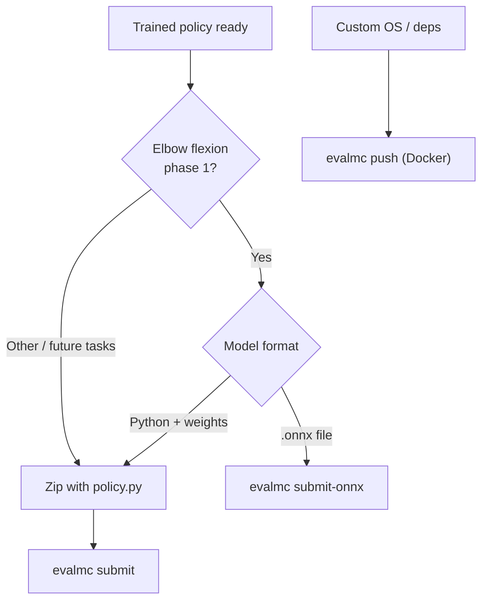

# MyoChallenge 2026 — Participant Guide

Train a controller for physiologically realistic musculoskeletal simulation and compete on the [leaderboard](https://mc26.myosuite.org).

| | |
|---|---|
| **Register** | [mc26.myosuite.org](https://mc26.myosuite.org) |
| **Leaderboard** | [mc26.myosuite.org](https://mc26.myosuite.org) |
| **MyoSuite** | [`ms3` branch](https://github.com/MyoHub/myosuite/tree/ms3) (Gymnasium API) |
| **CLI** | `pip install evalmc` |

---

## Quick start (≈5 minutes)

**Phase 1 — Elbow Flexion** is live now. The fastest way to verify your setup is an ONNX upload (no `policy.py` required).

### 1. Register your team

Register at [mc26.myosuite.org](https://mc26.myosuite.org) or via API:

```bash
curl -X POST https://api.mc.myosuite.org/register \
  -H "Content-Type: application/json" \
  -d '{"email": "team@example.com", "team_name": "MyTeam"}'
```

Save the **auth token** from the response — you need it to submit.

### 2. Install and authenticate the CLI

```bash
pip install evalmc
evalmc host --set-host https://api.mc.myosuite.org
evalmc login          # email + auth token from registration
evalmc status         # confirm host and team are configured
```

### 3. Submit a baseline model

**Option A — ONNX** *(simplest for elbow flexion)*

```bash
cd examples
pip install onnx numpy   # one-time, to export a test model
python export_elbow_onnx.py -o elbow_model.onnx
evalmc submit-onnx elbow_model.onnx -t elbowflexion -p 1
```

**Option B — policy zip** *(works for any task)*

```bash
cd examples
cp random_policy.py policy.py
zip my_baseline.zip policy.py policy_utils.py task_config.json
evalmc submit my_baseline.zip -t elbowflexion -p 1
```

You receive a **Submission ID** immediately. Scores appear on the leaderboard after async evaluation finishes. Check progress with `evalmc status` or the Submissions tab on the site.

---

## Choose your submission path



| Path | Best for | Command |
|---|---|---|
| **ONNX** | Elbow flexion; pure inference graphs | `evalmc submit-onnx model.onnx -t elbowflexion -p 1` |
| **Zip** | Any task; Python policies with bundled files | `evalmc submit policy.zip -t TASK -p 1` |
| **Docker** | Non-standard dependencies or base images | `evalmc push image:tag -t TASK -p 1` — see [DOCKER_SUBMISSION.md](DOCKER_SUBMISSION.md) |

For most teams, **zip or ONNX is enough**. Docker is only needed when you cannot fit your environment into a zip.

---

## Tasks

| Task | CLI name | Phase | Status | Environment |
|---|---|---|---|---|
| **Elbow Flexion** | `elbowflexion` | 1 | **Live** | `myoElbowPose1D6MRandom-v0` |
| Boxing | `boxing` | 1 | Coming soon | `myoChallengeBoxingP0-v0` |
| Fencing | `fencing` | 1 | Coming soon | `myoChallengeSaberP0-v0` |

### Observation and action shapes

| Task | obs shape | action shape | Notes |
|---|---|---|---|
| Elbow flexion (phase 1) | `(9,)` | `(6,)` | Muscle activations clipped to `[0, 1]` |
| Table tennis (phase 1) | `(78,)` | `(39,)` | Future task |
| Soccer (phase 1) | `(78,)` | `(39,)` | Future task |

Action dimension is resolved automatically during evaluation. For **local testing**, bundle [`examples/task_config.json`](examples/task_config.json) in your zip (see [`examples/policy_utils.py`](examples/policy_utils.py)).

---

## Zip submission (`policy.py`)

Your zip **must** contain `policy.py` at the root (not inside a subfolder):

```python
class Policy:
    def __init__(self):
        pass  # load weights from files in the zip

    def reset(self):
        pass  # called at the start of every episode

    def get_action(self, obs: np.ndarray) -> np.ndarray:
        ...  # return a 1-D float array, task-specific length
```

Templates and baselines live in [`examples/`](examples/README.md):

- [`policy.py`](examples/policy.py) — documented starter template
- [`random_policy.py`](examples/random_policy.py) — random baseline (good smoke test)
- [`elbow_policy.py`](examples/elbow_policy.py) — constant mid-range activations
- [`policy_utils.py`](examples/policy_utils.py) — action sizing without hard-coded dims

```bash
# policy.py at zip root; include any weights or configs alongside it
zip my_submission.zip policy.py weights.pt policy_utils.py task_config.json
evalmc submit my_submission.zip -t elbowflexion -p 1
```

---

## ONNX submission (elbow flexion)

Upload a standalone `.onnx` file. The eval harness runs it directly — no Python policy wrapper.

**Contract:** input tensor `obs` with shape `[batch, 9]`, output `action` with shape `[batch, 6]`. Activations are clipped to `[0, 1]` after inference.

```bash
evalmc submit-onnx my_model.onnx -t elbowflexion -p 1
```

Export a valid test model with [`examples/export_elbow_onnx.py`](examples/export_elbow_onnx.py).

---

## Local development

Install MyoSuite from the **`ms3`** branch:

```bash
git clone --recursive -b ms3 https://github.com/MyoHub/myosuite.git
cd myosuite && pip install -e . && python -m myosuite_init
python -m myosuite.utils.examine_env --env_name myoElbowPose1D6MRandom-v0
```

Test a zip policy locally before submitting:

```bash
cd examples
cp random_policy.py policy.py   # or use your own policy.py

python - <<'EOF'
import gymnasium as gym
import myosuite
import numpy as np
from policy import Policy

myosuite.register_all_envs()
env = gym.make("myoElbowPose1D6MRandom-v0")
policy = Policy()

obs, _ = env.reset()
policy.reset()
terminated = truncated = False
while not (terminated or truncated):
    action = policy.get_action(obs)
    obs, _, terminated, truncated, _ = env.step(action)
env.close()
print("Episode complete")
EOF
```

---

## Rules

- One active submission per team per task/phase at a time.
- Evaluation uses held-out seeds not available to participants.
- Policies must be self-contained — **no network access** during evaluation.
- Any observation post-processing or action pre-processing must happen inside `get_action` (or inside the ONNX graph).

---

## Troubleshooting

| Problem | Fix |
|---|---|
| `Zip must contain policy.py at its root` | Run `unzip -l my.zip` — `policy.py` must appear at the top level, not `src/policy.py` |
| `No credentials found` | Run `evalmc login` or pass `--email` and `--auth-token` |
| Wrong action shape locally | Add `task_config.json` next to `policy.py` (copy from `examples/`) |
| Docker eval fails after `evalmc push` | Remote workers cannot see images that exist only on your laptop — use zip/ONNX, or push to ECR per [DOCKER_SUBMISSION.md](DOCKER_SUBMISSION.md) |
| Scores not on leaderboard yet | Evaluation is async; check the Submissions tab or wait a few minutes |

---

## Questions

Open an issue in this repository or ask in [MyoHub discussions](https://github.com/MyoHub/myosuite/discussions).
