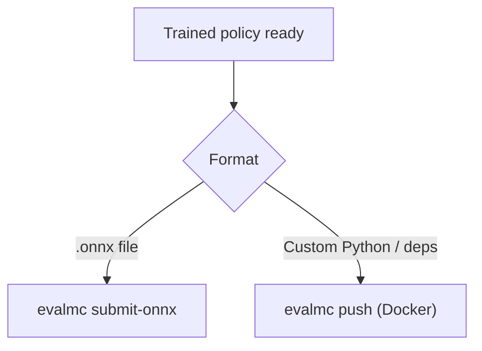

# MyoChallenge 2026 — Participant Guide

Train a controller for physiologically realistic musculoskeletal simulation and compete on the [leaderboard](https://mc26.myosuite.org).

| | |
|---|---|
| **Register** | [mc26.myosuite.org](https://mc26.myosuite.org) |
| **Leaderboard** | [mc26.myosuite.org](https://mc26.myosuite.org) |
| **MyoSuite** | [`ms3` branch](https://github.com/MyoHub/myosuite/tree/ms3) (Gymnasium API) |
| **CLI** | `pip install evalmc` |

---

## Quick start (≈5 minutes)

**New to the challenge?** Follow the step-by-step guide
[`tutorials/NEWBIE_QUICKSTART.md`](tutorials/NEWBIE_QUICKSTART.md)
(register → local smoke test → submit). Dependency rules for Docker agent images:
[`tutorials/SUBMISSION_DEPENDENCIES.md`](tutorials/SUBMISSION_DEPENDENCIES.md).

**Phase 1 — Elbow Flexion** and **ChaseTag** are live. The fastest way to verify your
setup is an ONNX upload (no `policy.py` required).

### 1. Register your team

Register at [mc26.myosuite.org](https://mc26.myosuite.org) or via API:

```bash
curl -X POST https://api.mc.myosuite.org/register \
  -H "Content-Type: application/json" \
  -d '{"email": "team@example.com", "team_name": "MyTeam"}'
```

Save the **auth token** from the response — you need it to submit.

### 2. Install and authenticate the CLI

```bash
pip install evalmc
evalmc host --set-host https://api.mc.myosuite.org
evalmc login          # email + auth token from registration
evalmc status         # confirm host and team are configured
```

### 3. Submit a baseline model

**ONNX** *(recommended — simplest for elbow flexion and ChaseTag)*

```bash
cd examples
pip install onnx numpy onnxruntime   # one-time, to export + smoke-test
python export_elbow_onnx.py -o elbow_model.onnx
python ../scripts/smoke_test_onnx.py elbow_model.onnx --task elbowflexion
evalmc submit-onnx elbow_model.onnx -t elbowflexion -p 1
```

Need custom Python around your weights? Build a Docker agent image and
`evalmc push` — see [DOCKER_SUBMISSION.md](DOCKER_SUBMISSION.md) and Path B in
[NEWBIE_QUICKSTART.md](tutorials/NEWBIE_QUICKSTART.md).

You receive a **Submission ID** immediately. Scores appear on the leaderboard after async evaluation finishes. Check progress with `evalmc status` or the Submissions tab on the site.

### Invitation-only tracks and title-cycle finals

Some task-phases are invitation-only. Their leaderboards remain visible, but an
organizer must approve your registered **team** before any ONNX or Docker
submission is accepted. The site disables submission when approval is missing.

For a `title_cycle` task, the mid-cycle board uses your best score. Before the
cycle freezes, choose the scored artifact that should play in finals:

```bash
evalmc nominate -t chasetag -p 1 --submission-id 123
```

You can replace a nomination while the cycle is open. Without one, the platform
uses your best in-window submission automatically.

---

## Choose your submission path



| Path | Best for | Command |
|---|---|---|
| **ONNX** | Pure inference graphs (elbow flexion, ChaseTag) | `evalmc submit-onnx model.onnx -t TASK -p 1` |
| **Docker** | Custom Python policies, non-standard deps, or base images | `evalmc push image:tag -t TASK -p 1` — see [DOCKER_SUBMISSION.md](DOCKER_SUBMISSION.md) |

For most teams, **ONNX is enough**. Use Docker when you need a `policy.py` wrapper,
libraries outside the task eval image, or a custom runtime.

**Important:** Docker agent images (and the task eval image for ONNX) supply libraries —
see [tutorials/SUBMISSION_DEPENDENCIES.md](tutorials/SUBMISSION_DEPENDENCIES.md) for the
allowed import list per task when you ship `policy.py` in a Docker image.

---

## Tasks

| Task | CLI name | Phase | Status | Environment |
|---|---|---|---|---|
| **Elbow Flexion** | `elbowflexion` | 1 | **Live** | `myoElbowPose1D6MRandom-v0` |
| **ChaseTag** | `chasetag` | 1 | **Live** | `myoChallengeChaseTagVsFullbody-v0` |
| Boxing | `boxing` | 1 | Coming soon | `myoChallengeBoxingP0-v0` |
| Fencing | `fencing` | 1 | Coming soon | `myoChallengeSaberP0-v0` |

### Observation and action shapes

| Task | obs shape | action shape | Notes |
|---|---|---|---|
| Elbow flexion (phase 1) | `(9,)` | `(6,)` | Muscle activations clipped to `[0, 1]` |
| ChaseTag (phase 1) | `(546,)` | `(354,)` | You control `agent_0`; harness opponent is `agent_1`. Role one-hot is the last 2 dims. |
| Table tennis (phase 1) | `(78,)` | `(39,)` | Future task |
| Soccer (phase 1) | `(78,)` | `(39,)` | Future task |

Action dimension is resolved automatically during evaluation. For **local testing** of a
`policy.py`, keep [`examples/task_config.json`](examples/task_config.json) next to your
policy (see [`examples/policy_utils.py`](examples/policy_utils.py)).

---

## ONNX submission *(primary path)*

Upload a standalone `.onnx` file. The eval harness runs it directly — no Python policy wrapper.

**Elbow flexion contract:** input tensor `obs` with shape `[batch, 9]`, output `action` with shape `[batch, 6]`. Activations are clipped to `[0, 1]` after inference.

**ChaseTag contract:** input `obs` with shape `[batch, 546]`, output `action` with shape `[batch, 354]` (you control `agent_0` in title-cycle matches).

```bash
evalmc submit-onnx my_model.onnx -t elbowflexion -p 1
evalmc submit-onnx chase.onnx -t chasetag -p 1
```

Export a valid elbow test model with [`examples/export_elbow_onnx.py`](examples/export_elbow_onnx.py),
then smoke-test shapes:

```bash
python scripts/smoke_test_onnx.py examples/elbow_model.onnx --task elbowflexion
```

**Train your own policy:** see the full tutorial [`tutorials/TRAIN_EXPORT_SUBMIT.md`](tutorials/TRAIN_EXPORT_SUBMIT.md) (Stable-Baselines3 or mjlab → ONNX export → `evalmc submit-onnx`).

---

## Docker submission (`policy.py` and/or `model.onnx`)

Use Docker when you need custom Python around your model (preprocessing, multi-file
checkpoints, packages not in the ONNX path). Your agent image must expose
`policy.py` and/or `model.onnx` under `/policy` or `/app`.

Full build and push guide: [DOCKER_SUBMISSION.md](DOCKER_SUBMISSION.md).

```python
class Policy:
    def __init__(self):
        pass  # load weights from files in the image (e.g. next to policy.py)

    def reset(self):
        pass  # called at the start of every episode

    def get_action(self, obs: np.ndarray) -> np.ndarray:
        ...  # return a 1-D float array, task-specific length
```

Templates and baselines live in [`examples/`](examples/README.md) — useful when building
a Docker agent image:

- [`policy.py`](examples/policy.py) — documented starter template
- [`random_policy.py`](examples/random_policy.py) — random baseline (good local smoke test)
- [`elbow_policy.py`](examples/elbow_policy.py) — constant mid-range activations
- [`chasetag_policy.py`](examples/chasetag_policy.py) — SB3 chaser/runner wrapper for ChaseTag
- [`policy_utils.py`](examples/policy_utils.py) — action sizing without hard-coded dims

```bash
# Minimal agent image, then push
cd examples
cp random_policy.py policy.py
docker build -t myteam-elbowflexion-p1:latest -f- . <<'EOF'
FROM python:3.10-slim
WORKDIR /policy
COPY policy.py policy_utils.py task_config.json .
EOF
evalmc push myteam-elbowflexion-p1:latest -t elbowflexion -p 1
```

---

## Local development

Install MyoSuite from the **`ms3`** branch:

```bash
git clone --recursive -b ms3 https://github.com/MyoHub/myosuite.git
cd myosuite && pip install -e . && python -m myosuite_init
python -m myosuite.utils.examine_env --env_name myoElbowPose1D6MRandom-v0
```

Test a `policy.py` locally before baking it into a Docker image:

```bash
cd examples
cp random_policy.py policy.py   # or use your own policy.py
python ../scripts/smoke_test_policy.py --task elbowflexion
```

Or the equivalent one-liner roll-out:

```bash
cd examples
cp random_policy.py policy.py

python - <<'EOF'
import gymnasium as gym
import myosuite
import numpy as np
from policy import Policy

myosuite.register_all_envs()
env = gym.make("myoElbowPose1D6MRandom-v0")
policy = Policy()

obs, _ = env.reset()
policy.reset()
terminated = truncated = False
while not (terminated or truncated):
    action = policy.get_action(obs)
    obs, _, terminated, truncated, _ = env.step(action)
env.close()
print("Episode complete")
EOF
```

---

## Rules

- One active submission per team per task/phase at a time.
- Evaluation uses held-out seeds not available to participants.
- Policies must be self-contained — **no network access** during evaluation.
- Any observation post-processing or action pre-processing must happen inside `get_action` (or inside the ONNX graph).
- Docker `policy.py` submissions may only import packages listed in [SUBMISSION_DEPENDENCIES.md](tutorials/SUBMISSION_DEPENDENCIES.md) (or install them in your own agent image).

---

## Tutorials

| Guide | Audience |
|---|---|
| [NEWBIE_QUICKSTART.md](tutorials/NEWBIE_QUICKSTART.md) | First-time register → smoke test → submit |
| [SUBMISSION_DEPENDENCIES.md](tutorials/SUBMISSION_DEPENDENCIES.md) | Allowed imports / what goes in a Docker agent image |
| [TRAIN_EXPORT_SUBMIT.md](tutorials/TRAIN_EXPORT_SUBMIT.md) | Train SB3 or mjlab → ONNX → submit |
| [DOCKER_SUBMISSION.md](DOCKER_SUBMISSION.md) | Custom libraries / CUDA / `policy.py` agents |

---

## Troubleshooting

| Problem | Fix |
|---|---|
| `ModuleNotFoundError` for `torch` / `sklearn` / … | Package not in the task image — see [SUBMISSION_DEPENDENCIES.md](tutorials/SUBMISSION_DEPENDENCIES.md); export ONNX or install deps in your Docker agent image |
| `No credentials found` | Run `evalmc login` or pass `--email` and `--auth-token` |
| Wrong action shape locally | Add `task_config.json` next to `policy.py` (copy from `examples/`); run `scripts/smoke_test_policy.py` |
| Docker eval fails after `evalmc push` | Remote workers cannot see images that exist only on your laptop — use ONNX, or push to ECR per [DOCKER_SUBMISSION.md](DOCKER_SUBMISSION.md) |
| Scores not on leaderboard yet | Evaluation is async; check the Submissions tab or wait a few minutes |

---

## Questions

Open an issue in this repository or ask in [MyoHub discussions](https://github.com/MyoHub/myosuite/discussions).
