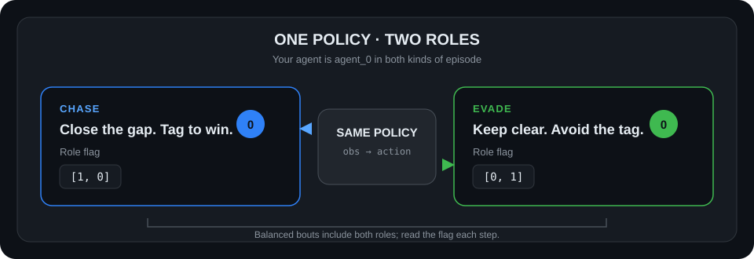
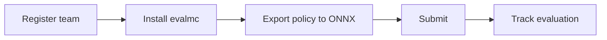
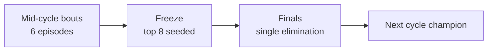

# MyoChallenge 2026 · ChaseTag

**Build a full-body policy that can both catch and evade.** Submit one controller, then compete in a balanced title-cycle format on the [MyoChallenge site](https://mc26.myosuite.org).

<div align="center">

| Environment | Roles | Observation → action | Episode |
|---|---|---|---|
| `myoChallengeChaseTagFBVs-v0` | Chase + evade | `546 → 354` | 10 seconds |

</div>

**Access:** invitation-only. An organizer must approve your team before submission. The site shows current track availability and cycle status.



**On this page:** [Start](#start-here) · [Submission format](#submission-format) · [Task contract](#task-contract) · [Title cycle](#title-cycle) · [Training](#train-and-test)

## Start here



1. Register at [mc26.myosuite.org](https://mc26.myosuite.org) and save your CLI token.
2. Install and configure the CLI:

   ```bash
   pip install -U "evalmc[check]"
   evalmc host --set-host https://api.mc.myosuite.org
   evalmc login
   evalmc status
   ```

3. Submit an ONNX model:

   ```bash
   evalmc submit-onnx examples/artifacts/chasetag_walker.onnx -t chasetag -p 1
   ```

   This repo includes a tested starter model at that path. It runs in both roles but is a starter policy, not a guarantee of competitive performance. Confirm the file exists and use the local export instead if you have trained a policy. ONNX input is `[batch, 546]`; output is `[batch, 354]`.
4. Follow the submission in the website’s **Submissions** tab. Evaluation runs asynchronously.

New to submissions? Follow the [ChaseTag quickstart](tutorials/NEWBIE_QUICKSTART.md).

## Submission format

**ONNX is the only accepted submission format.** Export your policy as a single ONNX inference graph and submit it with:

```bash
evalmc submit-onnx model.onnx -t chasetag -p 1
```

| Tensor | Shape | Type |
|---|---|---|
| input `obs` | `[batch, 546]` | `float32` |
| output `action` | `[batch, 354]` | `float32` |

Any preprocessing (normalization, role handling) must be part of the exported graph. Recurrent policies (GRU/LSTM) can add `<name>_in` / `<name>_out` state tensors, zeroed at each episode start. See the [ONNX submission contract](tutorials/SUBMISSION_DEPENDENCIES.md) for details.

**Resource limits.** Each match runs both players' policies and the two simulations in one container with **3 GB of memory**; a match that exceeds it is stopped and the submission fails. Keep everything (weights included) in the single `.onnx` file. Since `evalmc` 0.0.5, `submit-onnx` loads your model locally first and warns if it needs more than ~1 GB once loaded or more than 10 ms per action (large constant tables or index arrays can expand to several GB inside ONNX Runtime even when the file is small); it refuses files whose weights live in a separate `.onnx.data` file.

## Task contract

MyoSuite 3.1+ runs ChaseTag on the `myofullbody` model. Your policy controls `agent_0`; the opponent is `agent_1`. Role is included in the observation’s final two values:

| Role values | Meaning |
|---|---|
| `[1, 0]` | Chase: tag the opponent to win |
| `[0, 1]` | Evade: avoid being tagged until time expires |

Both roles appear in balanced, shuffled bouts. Do not infer your role from the opponent’s position. ChaseTag policies trained on the older MuscleMimic body may need retraining for MyoSuite 3.1+.

**Start positions are randomized.** In evaluation, both players' starting positions and headings vary slightly from the default MyoSuite reset in every episode. The change is mirrored, so both players get the same relative start, and each chase/evade pair of episodes shares it. The exact ranges are not published: train policies that are robust to small changes in the starting pose, not only to the default reset.

## Title cycle



- Mid-cycle bouts use 6 episodes: 3 chase and 3 evade. Every submission faces the fixed cycle champion; a win does not take the crown.
- Before freeze, nominate the scored submission you want considered for finals. Without a nomination, the best eligible in-window submission is used.
- **At freeze, the top 8 teams by mid-cycle Win Rate qualify for the finals.** The defending champion is seed #1 and the other seeds follow the mid-cycle ranking; seeds 1 and 2 can only meet in the final.
- Finals bouts use 10 episodes: 5 chase and 5 evade.
- Win Rate is episodes won divided by episodes decided (won + lost). Every episode ends in a tag, an escape (10 s without a tag), a chaser fall, or a player leaving the arena. An episode is void only if the physics simulation becomes numerically unstable; void episodes count for nobody. The leaderboard also reports role-specific rates and outcome counts.
- **Arena boundary:** the arena is 12 × 12 m, centred on the world origin. Each side has a 0.5 m sloped fence rising from ±6.0 m to its crest at ±6.5 m. A player whose pelvis goes beyond ±6.5 m on x or y has left the arena and loses the episode; if both leave on the same step, the chaser loses. Touching, stepping on or standing on the fence slope is allowed. Your policy observes its own pelvis position in world coordinates and its root orientation, so it can locate the fences. Applies to all Cycle 2 scoring and finals (entries scored before the rule were re-scored under it).
- Ties use episode wins and then earlier scoring for mid-cycle ranking.
- A finals bout tied after 10 episodes is settled by the first of these that separates the teams:
  1. **Overtime:** 2 more episodes (one each way) from new start positions, with the players starting **back to back**.
  2. More successful tags while chasing.
  3. More escapes while evading.
  4. Fewer falls while chasing.
  5. Closest approach while chasing (smaller average closest distance to the runner).
  6. A coin flip. Seeding is never used as a tiebreaker.

Exact dates, access, and current cycle status are shown on the [competition site](https://mc26.myosuite.org), which is the source of truth for live operations.

## Train and test

Install MyoSuite 3.1+ to run the environment locally:

```bash
python -m pip install -U 'myosuite>=3.1.0'
python -c "from myosuite import make_env; env=make_env('myoChallengeChaseTagFBVs-v0'); print(env.observation_space, env.action_space); env.close()"
```

See [training, checkpoint, and export](tutorials/TRAIN_EXPORT_SUBMIT.md) for the MyoSuite ChaseTag Colab workflow and ONNX export.

## Help

- [First submission guide](tutorials/NEWBIE_QUICKSTART.md)
- [ONNX submission contract](tutorials/SUBMISSION_DEPENDENCIES.md)
- [MyoChallenge support discussions](https://github.com/MyoHub/myosuite/discussions)
