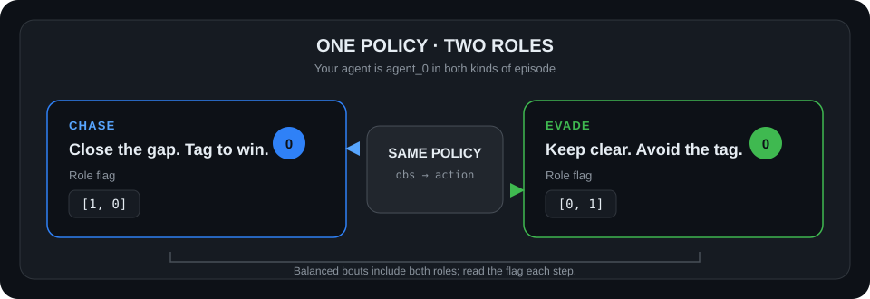
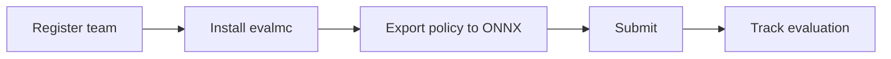
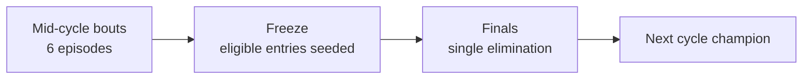

# MyoChallenge 2026 · ChaseTag

**Build a full-body policy that can both catch and evade.** Submit one controller, then compete in a balanced title-cycle format on the [MyoChallenge site](https://mc26.myosuite.org).

<div align="center">

| Environment | Roles | Observation → action | Episode |
|---|---|---|---|
| `myoChallengeChaseTagFBVs-v0` | Chase + evade | `546 → 354` | 10 seconds |

</div>

**Access:** invitation-only. An organizer must approve your team before submission. The site shows current track availability and cycle status.



**On this page:** [Start](#start-here) · [Submission format](#submission-format) · [Task contract](#task-contract) · [Title cycle](#title-cycle) · [Training](#train-and-test)

## Start here



1. Register at [mc26.myosuite.org](https://mc26.myosuite.org) and save your CLI token.
2. Install and configure the CLI:

   ```bash
   pip install evalmc
   evalmc host --set-host https://api.mc.myosuite.org
   evalmc login
   evalmc status
   ```

3. Submit an ONNX model:

   ```bash
   evalmc submit-onnx examples/artifacts/chasetag_walker.onnx -t chasetag -p 1
   ```

   This repo includes a tested starter model at that path. It runs in both roles but is a starter policy, not a guarantee of competitive performance. Confirm the file exists and use the local export instead if you have trained a policy. ONNX input is `[batch, 546]`; output is `[batch, 354]`.
4. Follow the submission in the website’s **Submissions** tab. Evaluation runs asynchronously.

New to submissions? Follow the [ChaseTag quickstart](tutorials/NEWBIE_QUICKSTART.md).

## Submission format

**ONNX is the only accepted submission format.** Export your policy as a single ONNX inference graph and submit it with:

```bash
evalmc submit-onnx model.onnx -t chasetag -p 1
```

| Tensor | Shape | Type |
|---|---|---|
| input `obs` | `[batch, 546]` | `float32` |
| output `action` | `[batch, 354]` | `float32` |

Any preprocessing (normalization, role handling) must be part of the exported graph. See the [ONNX submission contract](tutorials/SUBMISSION_DEPENDENCIES.md) for details.

## Task contract

MyoSuite 3.1+ runs ChaseTag on the `myofullbody` model. Your policy controls `agent_0`; the opponent is `agent_1`. Role is included in the observation’s final two values:

| Role values | Meaning |
|---|---|
| `[1, 0]` | Chase: tag the opponent to win |
| `[0, 1]` | Evade: avoid being tagged until time expires |

Both roles appear in balanced, shuffled bouts. Do not infer your role from the opponent’s position. ChaseTag policies trained on the older MuscleMimic body may need retraining for MyoSuite 3.1+.

## Title cycle



- Mid-cycle bouts use 6 episodes: 3 chase and 3 evade. Every submission faces the fixed cycle champion; a win does not take the crown.
- Before freeze, nominate the scored submission you want considered for finals. Without a nomination, the best eligible in-window submission is used.
- Finals bouts use 10 episodes: 5 chase and 5 evade. The defending champion is seed #1.
- Win Rate is episode wins divided by wins plus losses; draws are excluded. The leaderboard also reports role-specific rates and outcome counts.
- Ties use episode wins and then earlier scoring for mid-cycle ranking. Finals draws go to overtime and the published tournament tie-break rules.

Exact dates, access, and current cycle status are shown on the [competition site](https://mc26.myosuite.org), which is the source of truth for live operations.

## Train and test

Install MyoSuite 3.1+ to run the environment locally:

```bash
python -m pip install -U 'myosuite>=3.1.0'
python -c "from myosuite import make_env; env=make_env('myoChallengeChaseTagFBVs-v0'); print(env.observation_space, env.action_space); env.close()"
```

See [training, checkpoint, and export](tutorials/TRAIN_EXPORT_SUBMIT.md) for the MyoSuite ChaseTag Colab workflow and ONNX export.

## Help

- [First submission guide](tutorials/NEWBIE_QUICKSTART.md)
- [ONNX submission contract](tutorials/SUBMISSION_DEPENDENCIES.md)
- [MyoChallenge support discussions](https://github.com/MyoHub/myosuite/discussions)
