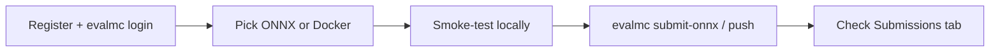

# Newbie quickstart — register, test locally, submit

Goal: go from zero to a **scored submission** in about 15 minutes.

Full dependency rules (Docker agent images): [SUBMISSION_DEPENDENCIES.md](SUBMISSION_DEPENDENCIES.md).

---

## Path overview



| Path | Best first try | Time |
|---|---|---|
| **A — ONNX** | Elbow flexion smoke model | ~5 min |
| **B — Docker** | Random `policy.py` agent image | ~15 min |

---

## 0. One-time setup

### Register

1. Open [mc26.myosuite.org](https://mc26.myosuite.org) → **Register your team**
2. Save the **CLI auth token** shown after registration (also on the Submissions tab)

### Install CLI

```bash
pip install evalmc
evalmc host --set-host https://api.mc.myosuite.org
evalmc login          # email + auth token
evalmc status         # should show host + team
```

### Clone this repo (examples + smoke tests)

```bash
git clone https://github.com/MyoHub/mc26eval.git
cd mc26eval
```

---

## Path A — ONNX baseline (recommended first)

No MyoSuite install required for export or remote eval.

```bash
cd examples
pip install onnx numpy onnxruntime

# 1) Build a valid elbow test model (obs[B,9] → action[B,6])
python export_elbow_onnx.py -o elbow_model.onnx

# 2) Local smoke test (shape check only)
python ../scripts/smoke_test_onnx.py elbow_model.onnx --task elbowflexion

# 3) Submit
evalmc submit-onnx elbow_model.onnx -t elbowflexion -p 1
```

You get a **Submission ID** immediately. Open the site → **Submissions** (or wait
a few minutes) for `scored` / `failed`.

**ChaseTag ONNX** uses the same command with `-t chasetag` once you have a model
with shapes `obs[B,546]` → `action[B,354]`.

---

## Path B — Docker baseline (custom Python)

Use this when you need a `policy.py` wrapper, multi-file checkpoints, or packages
beyond a standalone ONNX upload. Full guide: [DOCKER_SUBMISSION.md](../DOCKER_SUBMISSION.md).

### B1. Prepare a random policy (elbow)

```bash
cd examples
cp random_policy.py policy.py
# optional local roll-out (needs MyoSuite >=3.1.0):
#   python ../scripts/smoke_test_policy.py --task elbowflexion
```

### B2. Local smoke test (optional but recommended)

Needs MyoSuite **3.1+**:

```bash
# one-time MyoSuite install
pip install -U 'myosuite>=3.1.0'

# from mc26eval/examples (policy.py already copied)
python ../scripts/smoke_test_policy.py --task elbowflexion
```

Expected: `Episode complete` / exit code 0.

### B3. Build and push

```bash
cd examples
docker build -t myteam-elbowflexion-p1:latest -f- . <<'EOF'
FROM python:3.10-slim
WORKDIR /policy
COPY policy.py policy_utils.py task_config.json .
EOF
evalmc push myteam-elbowflexion-p1:latest -t elbowflexion -p 1
```

Production hosts require an ECR push (the CLI handles credentials). Do not submit a
laptop-only tag to `api.mc.myosuite.org` without completing that flow.

### ChaseTag Docker

ChaseTag’s eval image includes `torch`, `stable_baselines3`, and related packages.
You can still ship your own agent image with checkpoints baked in:

```bash
cd examples
cp chasetag_policy.py policy.py
# COPY policy.py + checkpoints into /policy in your Dockerfile
evalmc push myteam-chasetag-p1:latest -t chasetag -p 1
```

Scoring is a **title cycle** (everyone vs a fixed Cycle Champion). See the
Challenge tab on the site for cycle rules.

---

## Checklist before every submit

- [ ] ONNX: shapes match the task contract; smoke test passed
- [ ] Docker: `policy.py` and/or `model.onnx` under `/policy` or `/app`
- [ ] Every weight file the policy opens is **inside the image**
- [ ] Imports are only from the [allowed list](SUBMISSION_DEPENDENCIES.md) (or installed in your agent image)
- [ ] No downloads / network calls in `__init__` or `get_action`
- [ ] Local smoke test passed (when MyoSuite is available)
- [ ] `evalmc status` shows the correct host and team

---

## If evaluation fails

| Symptom | Likely cause | Fix |
|---|---|---|
| `ModuleNotFoundError: torch` (elbow agent) | Torch not in elbow image / your Dockerfile | Export ONNX or install torch in the agent image |
| Wrong action shape | Hard-coded dims / missing config | Bundle `task_config.json`; use `policy_utils.get_action_dim()` |
| Stuck on `submitted` | Worker queue | Wait; check Submissions tab for `evaluating` → `scored` |
| `failed` after evaluate | Import/runtime error | Expand the row on Submissions for worker detail |
| Docker image not found remotely | Local-only tag | Complete ECR push, or use ONNX |

---

## Learn more

| Guide | When |
|---|---|
| [SUBMISSION_DEPENDENCIES.md](SUBMISSION_DEPENDENCIES.md) | “Can I import X?” |
| [TRAIN_EXPORT_SUBMIT.md](TRAIN_EXPORT_SUBMIT.md) | Train SB3/mjlab → ONNX → submit |
| [../examples/README.md](../examples/README.md) | File-by-file examples |
| [../DOCKER_SUBMISSION.md](../DOCKER_SUBMISSION.md) | Custom libraries / CUDA / `policy.py` |
| [../README.md](../README.md) | Full participant guide |
